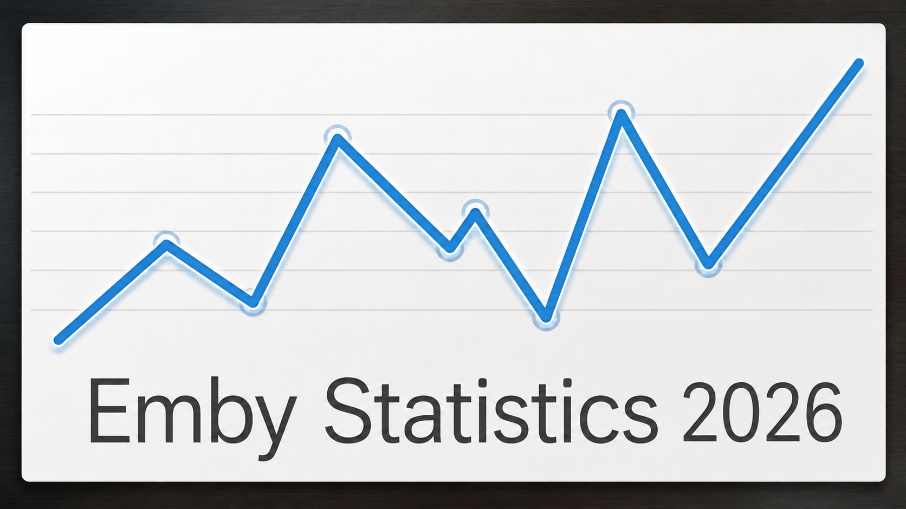

# Codec Info plugin for Emby Server


This is a plugin for Emby server. If you do not already have Emby server installed please go to [https://emby.media](https://emby.media) and download the server. Otherwise this plugin will be very useless for you.

The development environment assumes you are running the server and developing your plugin on on a Windows Device.  See the Unix section below installation on Unix/OSX.

## Reasoning
Why create a new Statistics plugin?  It started with problems my users were having with DolbyVision Profile 5.0. Complaints about pink or
blue etc etc, became a nuisance, so I wanted to find any DV 5.0 profile in my library.

Nothing existed, but the existing statistics plugin was close.  So I extended it.

However, I really wanted to dive into creating a plugin, as I had a couple of ideas for them.  So I started playing around.

I decided to re-write most of it, dramatically changing the architecture.

Top Changes:
1. No longer use the config file for data, its all moved into a SQL database.
1. Speed improvement.  My library (5311 movies and 17224 episodes) took about 14 minutes on my media server to run the old statistics. It now runs in less than 4.
1. User pages - Users can now see their statistics.

## Issues - To be added
1. Sorting of lists

## Setup
1. The solution relies on the external file called [InstallAndLaunch.bat](https://raw.githubusercontent.com/towel42-com/EmbyPluginUtils/trunk/InstallAndLaunch.bat).
It is part of the [Towel42/EmbyPluginUtils](https://github.com/towel42-com/EmbyPluginUtils) repositiory.  

    This file gets used in two locations
    
        * As a post build event call
        * As a launch script for debugging

    In the Statistics2026.csproj file, you will find a root level property group defining the variable InstallAndLaunchPath.
    
    After you download the file, update the csproj with the correct full path to the batch file you downloaded.
    
1. Next, In the Statistics2026.csproj file, in the PostBuild target section, you will find a series of Property groups defining EmbyServerRoot.

    I tend to keep 2 development servers, one is a copy of my full production server used for scale testing.  The other is a small subset.
    I do not develop on my host server, so all my installations are zip file installations.  

    If you are developing on an installed server, using Default should work fine.
    
    In the csproj file, you will find a Target with the Name "DetermineEmbyRoot".  Update the values for your installations.
    
    In Statistics2026/Properties you will find 'launchSettings.json'. Here is where you setup your debugging profiles.  Their names should match the conditionals
    setup in the csproj file.
   
If you set InstallAndLaunchPath and EmbyServerRoot correctly, no further work should be necessary to install and test the plugin.

## Installation
Whenever you build, the dll is installed to the correct location inside your Emby Server.  However, if the server is currently running, it will not be used until the server is restarted

## Debugging
When you launch a debug session, the InstallAndLaunch batch file, will shut down and locally running EmbyServers and their child processes.  Note, this may close your 
browsers, as they may have been launched as a child process.

After shutdown, the plugin will be copied to the correct location, and the Server will be launched.

In order to debug the C# plugin, you must attach to the process.

This can be done in two ways, SHIFT-ALT-P is the default short cut for "Reattach to process".  If no previous session has been run, it will prompt you with a list of executables.  Select EmbyServer.exe. Note, Your shortcut may be different. If so, under Debug you should find a "Attach to Process" menu item.

Or you can have the debugger attached automatically by setting #define DEBUG_PLUGIN in [Statistics2026/Utilities/HelperFuncs.cs](Statistics2026/Utilities/HelperFuncs.cs) which will automatically attach to the current debugger.

You must have your **OWN** tmdb api key. See below on how to modify the Statistics2026/Statistics2026.csproj.user file

### DEBUG Compile time flags
* DEBUG_PLUGIN_IMAGES
  * When defined, on startup the server will copy all server images (not library images) from the server to a local repo.
  * You define the server path and local repo path by the Statistics2026/Statistics2026.csproj.user file (see below)
* DEBUG_PLUGIN_ASYNC
  * When defined, limits parallel analysis to 1 thread at a time
* DEBUG_DB
  * Limits the user to those named in the user project file (see below)
  * Enables the DB Monitor logger, puts out information on access to the db and other calls

### Modifying Statistics2026/Statistics2026.csproj.user ###
There is a sample file in Statistics2026 sub-directory called [Statistics2026/Statistics2026.csproj.user.sample](Statistics2026/Statistics2026.csproj.user.sample) 

1. copy this file to Statistics2026/Statistics2026.csproj.user
2. Edit the file modifying the following property group in the newly created files

```xml
  <PropertyGroup>
    <!-- Visual Studio will read these properties automatically when building -->
    <TmdbApiKeyV3>XXXXXX</TmdbApiKeyV3>
    <TmdbApiKeyV4>XXXXXX</TmdbApiKeyV4>
    <OldServerLocation>\\ServerLocation</OldServerLocation>
    <NewServerLocation>C:\LocalStorageLocation</NewServerLocation>
    <LimitUsersTo>["username1", "username2"]</LimitUsersTo>
  </PropertyGroup>
```
Changing out values as necessary.

### Unix
You need to copy the generated DLL into "/var/lib/emby-server/plugins" folder, set emby as the Group:Owner, restart your Emby server and the new plugin should be visible.


